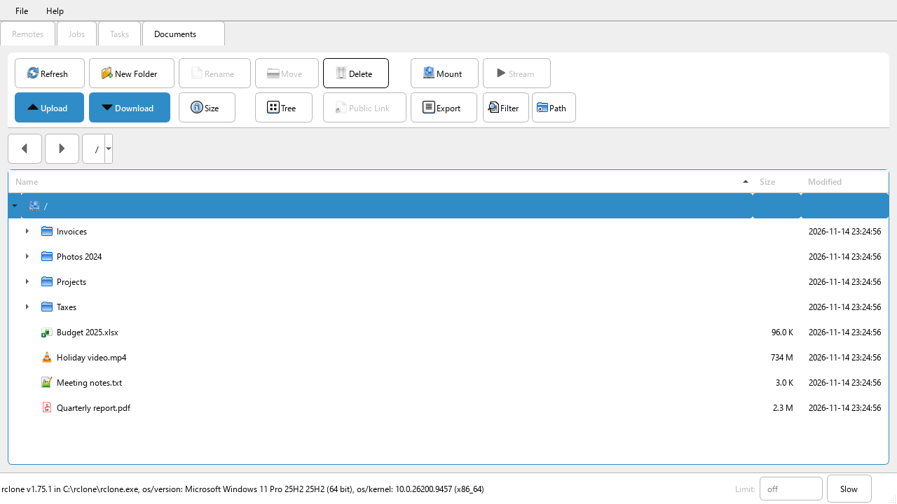

# Rclone Browser NG

[](https://github.com/SysAdminDoc/RcloneBrowserNG/releases)
[](LICENSE)
[](#build-instructions)
[](https://www.qt.io/)

<p align="center">
  <a href="https://ko-fi.com/X8K126YVER">
    
  </a>
</p>

<p align="center">
  <sub><em>If this project helps you, a coffee helps me keep working on it.</em></sub>
</p>

Simple cross-platform GUI for the [rclone](https://rclone.org/) command line tool.

Community continuation of [kapitainsky/RcloneBrowser](https://github.com/kapitainsky/RcloneBrowser) (itself a fork of [mmozeiko/RcloneBrowser](https://github.com/mmozeiko/RcloneBrowser)). Both upstream repositories are abandoned; this fork restores compatibility with modern rclone and Qt 6 and continues fixing bugs and adding features.

Supports Windows, macOS, GNU/Linux and the BSD family.



## What NG fixes over the abandoned upstream

*   Works with modern rclone (v1.56+) — transfer progress, size, bandwidth and ETA parse correctly again
*   Builds with Qt 6 (minimum 6.4) — required for Wayland and current Linux distributions
*   `rclone config` works with modern terminal emulators (gnome-terminal 3.38+, kitty, alacritty, wezterm, foot, tilix, …)
*   Delete runs as a background job instead of freezing the GUI
*   Multiple simultaneous mounts work on Windows (RC port collision fixed)
*   Cancelled jobs actually terminate the underlying rclone process
*   Many crash, reliability and dark-mode fixes — see [CHANGELOG.md](CHANGELOG.md)

## Features

*   Browse and modify any rclone remote, including encrypted ones
*   Uses the same configuration file as rclone — no extra configuration required
*   Custom location and encryption support for `rclone.conf`
*   Navigate multiple remotes simultaneously in separate tabs
*   Hierarchical file listing with name, size and modify date
*   Visible path and filter controls for faster browsing without relying on hidden shortcuts
*   All rclone commands run asynchronously — no GUI freezing
*   Lazily cached file hierarchy for fast folder traversal
*   Upload, download, create folders, rename, move and delete files and folders
*   Calculate folder sizes, export file lists, copy rclone commands to clipboard
*   Run multiple jobs in the background, with per-file progress
*   Cohesive light and dark native interface with clear focus states, status badges, context-aware action hints, inline validation and polished empty/loading/error feedback
*   Drag & drop from your file explorer to upload
*   Stream media files to a player such as [mpv](https://mpv.io/) or [VLC](https://www.videolan.org)
*   Mount and unmount remotes (Windows needs [WinFsp](https://winfsp.dev/); macOS can use macFUSE 5.2+, fuse-t, or rclone `nfsmount` when available)
*   Put several remotes together as one, so they browse and mount as a single drive
*   Optional tray icon with finished-transfer notifications
*   Portable mode — keep the app, rclone and its config on a memory stick
*   Google Drive "shared with me" support
*   Public link generation for remotes that support sharing
*   Saved tasks — create a job once, then run or edit it later (with dry-run support)
*   Configurable dark mode on all systems

## How to get it

Windows builds are on the [releases](https://github.com/SysAdminDoc/RcloneBrowserNG/releases/latest) page: an installer, a portable zip, and a source archive. Every release ships a `SHA256SUMS` file, so check your download before running it:

```text
sha256sum -c SHA256SUMS
```

The Windows binaries are **not code-signed**, so SmartScreen warns on first run. Verify the checksum, then choose More info and Run anyway. Signing needs a certificate the project does not have yet.

For macOS, Linux and BSD, build from source with the instructions below. Artifacts are built and published by the maintainer from a local machine; this repository does not provide a CI build or artifact-attestation service.

### Local release verification

Before publishing a locally built artifact, run:

```text
python scripts/release_check.py
```

The harness validates version and release disclosures, parses AppStream metadata, checks the local release scripts, builds the selected Release configuration, runs the offscreen CTest suite, and smoke-tests the built executable with `--version`. It prints the CI-only guarantees that are intentionally unavailable here; platform packaging remains an explicit step through the matching script in `scripts/`.

### Package-manager manifest artifacts

After the platform artifacts and a source archive are present in `release/`, generate reviewable, non-submitted package-manager manifests with:

```text
python scripts/generate_package_manifests.py --release-dir release --output release/package-manifests --require windows --require macos --require flatpak
```

The generator writes Chocolatey, Homebrew Cask and Flatpak files with the exact artifact URLs and SHA256 values, and checks each one before it finishes. It also writes `manifest-index.json` with `"submitted": false`. Nothing gets published or submitted until the maintainer does it by hand.

### Signing an AppImage

Set `RCLONE_BROWSER_APPIMAGE_SIGN_KEY` to a GPG key ID or fingerprint from your keyring before running `scripts/release_AppImage.sh`, and it embeds a signature in the AppImage. A key that isn't there stops the script before it builds anything. Anyone can print the signature with `./RcloneBrowserNG-*.AppImage --appimage-signature`.

## Build instructions

### Linux

1.  Install dependencies:
    *   **Debian/Ubuntu**: `sudo apt update && sudo apt -y install git g++ cmake make qt6-base-dev libgl1-mesa-dev`
    *   **Fedora**: `sudo dnf -y install git g++ cmake make qt6-qtbase-devel`
    *   **Arch/Manjaro**: `sudo pacman -Sy --noconfirm --needed git gcc cmake make qt6-base`
2.  `git clone https://github.com/SysAdminDoc/RcloneBrowserNG.git && cd RcloneBrowserNG`
3.  `mkdir build && cd build`
4.  `cmake ..`
5.  `make`
6.  `sudo make install`

### FreeBSD

1.  `sudo pkg install git cmake qt6-base`
2.  Then follow the Linux steps from step 2.

*Note: for rclone mounts to work you may need `sudo sysctl vfs.usermount=1` — see this rclone forum [thread](https://forum.rclone.org/t/failed-to-mount-fuse-fs-freebsd/7723/9).*

*Note: rclone does not support `mount` on OpenBSD/NetBSD, so the feature is disabled there.*

### macOS

1.  Install [Homebrew](https://brew.sh/) if you don't have it
2.  `brew install git cmake rclone qt@6`
3.  `git clone https://github.com/SysAdminDoc/RcloneBrowserNG.git && cd RcloneBrowserNG`
4.  `mkdir build && cd build`
5.  `cmake .. -DCMAKE_PREFIX_PATH=$(brew --prefix qt@6)`
6.  `make`
7.  Package with Qt libraries to create a self-contained app: `$(brew --prefix qt@6)/bin/macdeployqt build/rclone-browser.app`

For macOS mounts, install a current userspace backend: macFUSE 5.2 or newer, fuse-t, or an rclone build that includes `nfsmount`. Rclone Browser NG detects these at mount time and avoids steering users toward legacy kext-only setups.

### Windows

1.  Install [Visual Studio 2022](https://visualstudio.microsoft.com/) (the "Desktop development with C++" workload is enough — Build Tools also work)
2.  Install [CMake](https://cmake.org/)
3.  Install Qt 6 (64-bit, MSVC) from the [Qt website](https://www.qt.io/download-open-source/) — release packaging should use Qt 6.8.8+ or 6.11.1+; these steps assume `C:\Qt`
4.  `git clone https://github.com/SysAdminDoc/RcloneBrowserNG.git && cd RcloneBrowserNG`
5.  `mkdir build && cd build`
6.  `cmake -G "Visual Studio 17 2022" -A x64 -DCMAKE_CONFIGURATION_TYPES="Release" -DCMAKE_PREFIX_PATH=C:\Qt\6.8.8\msvc2019_64 .. && cmake --build . --config Release`
7.  `C:\Qt\6.8.8\msvc2019_64\bin\windeployqt.exe --no-translations ".\build\Release\RcloneBrowser.exe"`
8.  `build\Release` now contains `RcloneBrowser.exe` and everything required to run it

## Combining remotes

To see several remotes as one drive, right-click a remote in the list and choose **Combine With Other Remotes...**, or click **New Remote...** and pick the `combine` type. Tick the remotes you want and name the new one. Each remote becomes a folder inside it, and you can rename that folder or point it at a path inside the remote instead of the whole thing.

Nothing is copied or moved. The app adds an rclone [combine](https://rclone.org/combine/) remote to your `rclone.conf`, which you open like any other remote. Its Mount button puts all of them on one drive letter or mount point.

## Portable vs standard mode

In standard mode, settings and saved tasks live in the usual per-user places:

*   macOS:
    *   preferences: `~/Library/Preferences/com.rclone-browser-ng.rclone-browser-ng.plist`
    *   tasks file: `~/Library/Application Support/rclone-browser-ng/rclone-browser-ng/tasks.json`
*   Linux/BSD:
    *   preferences: `~/.config/rclone-browser-ng/rclone-browser-ng.conf`
    *   tasks file: `~/.local/share/rclone-browser-ng/rclone-browser-ng/tasks.json`
*   Windows:
    *   preferences: registry `HKEY_CURRENT_USER\Software\rclone-browser-ng\rclone-browser-ng`
    *   tasks file: `%LOCALAPPDATA%\rclone-browser-ng\rclone-browser-ng\tasks.json`

The app log is in a `logs` folder beside the tasks file.

NG 2.0.2 and earlier used classic Rclone Browser's `rclone-browser` locations instead, so the two apps overwrote each other's settings. The first time a newer NG starts, it copies from the old locations and leaves them as they were:

*   your preferences, if NG doesn't have any of its own yet
*   NG's `tasks.json` and `job-history.json`
*   the tasks in classic's `tasks.bin`, apart from ones NG already has

Classic keeps its `tasks.bin`, since NG only reads it. A `tasks.bin.corrupt` left by NG 2.0.2 gets its old name back, unless classic has already made a new one. The copy happens once. After that a change made in one app doesn't reach the other. Going back to 2.0.2 puts you on the old shared settings again, without any task you made after upgrading.

NG doesn't rename or delete a tasks file it can't read. It leaves an unreadable `tasks.bin` where it is. For an unreadable `tasks.json`, it saves a copy called `tasks.json.unreadable` before writing a new one.

To turn on portable mode, put an `.ini` file with the executable's name next to it. For `RcloneBrowser.exe` that's `RcloneBrowser.ini`, and on macOS it goes next to the `.app` bundle. For a Linux AppImage, make a folder named `<appimage>.config` next to the AppImage file, as the [AppImage portable-mode spec](https://docs.appimage.org/user-guide/portable-mode.html) describes.

Portable mode keeps all configuration next to the application, and the rclone binary and `rclone.conf` paths can be relative to the executable, so everything can live on a USB stick. It uses the same files it always has.

## History

This project keeps a long-running community tool alive. Martins Mozeiko wrote the original Rclone Browser; kapitainsky maintained a widely-used fork through 2020 with many fixes and features; both repositories then went dormant while rclone kept evolving and eventually broke them. RcloneBrowserNG picks up from the kapitainsky line with modern rclone and Qt 6 compatibility.
